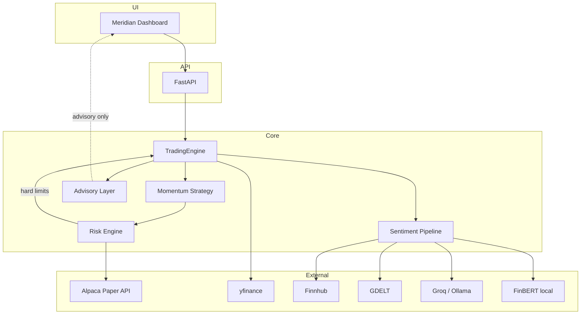

# Meridian — AI Stock Trading Bot

Paper-first Python trading service: **volatility-scaled time-series momentum** across a diversified ETF + large-cap universe, with cross-sectional tilt, 1–2 day news-sentiment filter, optional walk-forward ML, and a polished dashboard.

**Honest accuracy:** no free method reliably beats ~51–55% daily directional accuracy out-of-sample. Target Sharpe **0.5–1.0 after costs**. LLM agents often fail long-horizon buy-and-hold comparisons ([FINSABER](https://github.com/waylonli/FINSABER)). See [docs/research/](docs/research/).

## Features

- **Broker:** Alpaca paper trading via `alpaca-py` (default). Pluggable `Broker` ABC + **IBKR stub** for later live use.
- **Data:** Alpaca Market Data Basic (IEX) for live; **yfinance** for historical backtests only.
- **Strategy:** vol-scaled trend, cross-sectional momentum tilt, sentiment block/boost, optional XGBoost walk-forward.
- **News:** Finnhub (optional) + GDELT (no key). Sentiment: local FinBERT → pluggable LLM (Groq / Ollama / OpenAI-compatible), entity-anonymised, cached, rate-limited.
- **Advisory:** TradingAgents-style multi-agent LLM research — **never places orders, never overrides risk**.
- **Risk:** position limits, stop-loss, daily loss cap, max-drawdown kill switch, PDT awareness, fractional shares, market hours/holidays.
- **Validation:** vectorbt-friendly walk-forward, purged/embargo folds, holdout after LLM cutoff, fees/slippage, deflated Sharpe / PBO proxy, vs buy-and-hold.
- **UI:** FastAPI + Meridian desk dashboard (setup wizard, signals, news, validation, risk, logs).
- **Ops:** Docker, Makefile, pre-commit, GitHub Actions CI, typed settings, pytest.

## Architecture



## Quickstart

```bash
python -m venv .venv && source .venv/bin/activate
pip install -e ".[dev,e2e]"
cp .env.example .env
# Add ALPACA_API_KEY / ALPACA_SECRET_KEY (paper). Without keys, paper_sim is used.

make api          # http://127.0.0.1:8000
make test         # unit + integration
make sample-validation
```

Live trading is **off by default**. Enabling it requires `TRADING_MODE=live`, `LIVE_TRADING_ENABLED=true`, and `LIVE_TRADING_CONFIRM=I_UNDERSTAND_THE_RISKS`, plus `ALPACA_PAPER=false`.

## Accounts & API keys

| Service | Free / Paid | Purpose | Signup | Env var(s) | Required? | Pakistan notes |
|--------|-------------|---------|--------|------------|-----------|----------------|
| **Alpaca paper** | Free paper | Broker + IEX market data | [app.alpaca.markets/signup](https://app.alpaca.markets/signup) | `ALPACA_API_KEY`, `ALPACA_SECRET_KEY` | **Required** for real paper brokerage (else in-memory `paper_sim`) | Paper-only accounts open **worldwide** (email only). Real-money Alpaca may be restricted; use IBKR later for live. |
| **Finnhub** | Free tier (60/min) | Company news | [finnhub.io/register](https://finnhub.io/register) | `FINNHUB_API_KEY` | Optional | Available |
| **Groq** | Free tier | LLM sentiment / advisory | [console.groq.com/keys](https://console.groq.com/keys) | `GROQ_API_KEY`, `LLM_PROVIDER=groq` | Optional | Available |
| **Ollama** | Free local | Local LLM | [ollama.com](https://ollama.com) | `OLLAMA_BASE_URL`, `LLM_PROVIDER=ollama` | Optional | Local — no cloud signup |
| **OpenAI-compatible** | Varies | Alternate LLM endpoint | Provider-specific | `OPENAI_API_KEY`, `OPENAI_BASE_URL`, `LLM_PROVIDER=openai_compatible` | Optional | Depends on provider |
| **GDELT** | Free, **no key** | Global news | — | — | Optional (on by default) | No signup |
| **FinBERT** | Free local model | Baseline sentiment | Hugging Face auto-download | — | Optional (default fallback) | No signup; first run downloads weights |
| **yfinance** | Free public | Historical backtests only | — | — | Used for validation | No signup |
| **IBKR** | Live broker (stub) | Future real-money | [interactivebrokers.com](https://www.interactivebrokers.com) | TBD | Not implemented | Accepts Pakistan for live; stub only today |

**No signup required:** GDELT, yfinance/public Yahoo data, FinBERT (local), Ollama (local), in-repo `paper_sim`.

## Configuration

- Env: `.env` (from `.env.example`) — **never commit secrets**
- YAML: `config/settings.yaml` — universe, strategy, risk, validation
- Feature flags: `ENABLE_ML_MODEL`, `ENABLE_NEWS_SENTIMENT`, `ENABLE_TRADING_AGENTS_ADVISORY`

## Commands

| Command | Description |
|---------|-------------|
| `make api` | Start dashboard |
| `make test` | Unit + integration |
| `make test-e2e` | Playwright UI tests |
| `make sample-validation` | Walk-forward report → `data/cache/validation_report.json` |
| `make docker-up` | Compose stack |
| `python -m trading_bot.cli setup-check` | Credential wizard (CLI) |

## Agent / contributor entry

Start at **[AGENTS.md](AGENTS.md)** (also [CLAUDE.md](CLAUDE.md)). Cursor rules in `.cursor/rules/`, skills in `.cursor/skills/`, auditors in `.cursor/agents/`. Knowledge base under `docs/`.

## License

MIT
